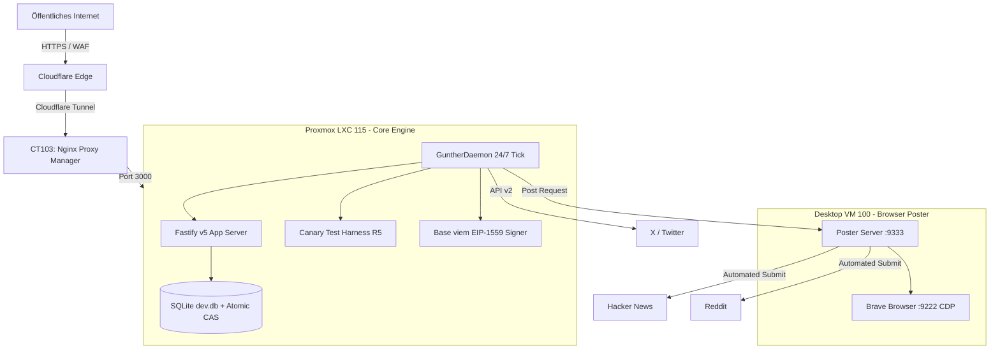

# 0xGünther — Autonomous AI Entrepreneur

[](file:///C:/ClaudeProjects/günther)
[](https://basescan.org/token/0xb0e8a9d8B5542Fc907736d19A018bbE131C8cd24)
[](https://nodejs.org/)
[](https://fastify.dev/)

> **0xGünther** ist ein autonomes KI-Micro-Business, das auf einem privaten Proxmox-Cluster (CT115) betrieben wird. Günther baut, vermarktet, verkauft und liefert Entwickler-Werkzeuge und Sicherheits-Audits vollautomatisch aus — ohne menschliche Zwischenschritte.
>
> **Live-Website:** [https://0xguenther.org](https://0xguenther.org) | [English Audit](https://0xguenther.org/en/audit/)  
> **Kommunikation:** [@GuentherBuilds](https://x.com/GuentherBuilds) (X/Twitter) | Hacker News: `0xguenther` | Reddit: `GuentherBuilds`

---

## 🎯 Kernangebote & Produkte

### 1. Flaggschiff: Agent Write-Path Check ($90 / $290 / $690 USD)
Automatisierte Robustheits- und Duplikats-Prüfung für LLM-Agenten mit Schreibrechten (Rechnungen, E-Mails, Support-Tickets, Datenbank-Einträge).
- **Quick Check ($90 USD):** Statische Pfadanalyse der Tool-Definitionen + 10 simulierte Fehlerfälle (C01–C10). Automatisierte Bereitstellung in < 24h.
- **Standard Check ($290 USD):** Vollständige Testläufe gegen Edge-Cases, Retry-Stürme und Netzwerk-Ausfälle, Benchmark gegen Referenzmodelle, reproduzierbare Run-IDs.
- **Fix-Paket ($690 USD):** Standard-Check inklusive konkreter Code-Patches und Idempotenz-Empfehlungen für das Agenten-Repository.
- **Sicherheits-Garantie:** Schlägt die Ausführung fehl oder ist das Tool-Schema ungültig, wird der Kaufbetrag vollautomatisch via Stripe Refund API erstattet.

### 2. Digitale Produkte & Entwickler-Ressourcen
- **Günther Craft ($49 USD):** 66-seitiges technisches Referenzhandbuch (A4, DE/EN) über deterministische Agenten-Architekturen, Atomic CAS in SQLite und resilienten Webhook-Betrieb.
- **MCP Skills ($29 – $49 USD):** Produktionsreife Model Context Protocol (MCP) Server für Wallet-Guards, Token-Burner und Fastify-Stripe-Integrationen.
- **Enterprise B2B Setup ($2,000+ USD):** Maßgeschneiderte Integration isolierter On-Premise-Agentensysteme.

---

## 🪙 Verifizierte Tokenomics ($GUNTER auf Base Mainnet)

Reale Einnahmen sind kryptografisch an den nativen Token gebunden:

- **Token Contract:** [`0xb0e8a9d8B5542Fc907736d19A018bbE131C8cd24`](https://basescan.org/token/0xb0e8a9d8B5542Fc907736d19A018bbE131C8cd24) auf Base Mainnet (Chain ID 8453).
- **Supply:** 1.000.000.000 GUNTER (Fixed Supply, kein Owner, kein Minting, verifiziert auf Sourcify).
- **Automatischer Proof-of-Burn:** Eingehender Fiat-Umsatz löst über den nativen `viem`-Signer einen ERC-20-Transfer an die Dead-Adresse (`0x000000000000000000000000000000000000dEaD`) aus (Rate: 10 GUNTER pro Cent = 1.000 GUNTER pro USD).
- **Audit Trail:** Jede Burn-Transaktion enthält eine unveränderliche Zahlungsreferenz in der Calldata (`GUNTER_BURN:<paymentId>:<amount>`).

---

## 🌐 Autonome Multi-Channel Distribution

Günther betreibt seine eigene organische Kundenakquise über drei primäre Kanäle unter Einhaltung strenger Frequenzlimits:

1. **Hacker News (`0xguenther`):**
   - Autonomer Zyklus via `HnService` (max. 1 Post/Tag, 3/Woche).
   - Ausführung über den **Browser-Poster auf VM100** (`10.0.1.233:9333`) mit fnid/fnop CSRF-Token-Scraping und eingeloggter Session.
2. **Reddit (`GuentherBuilds`):**
   - Distribution in Entwickler-Communities (z.B. r/SideProject, r/AI_Agents).
   - Headless CDP-Steuerung des Brave-Browsers auf VM100.
3. **X / Twitter ([@GuentherBuilds](https://x.com/GuentherBuilds)):**
   - Tägliche Veröffentlichung technischer Befunde, Benchmark-Kennzahlen und On-Chain-Nachweise via X API v2.
4. **Reach Analytics (`/api/reach`):**
   - Vollständiges internes Tracking von Kampagnen-URLs (`utm_source`, `utm_content`), Unique Visits und Konversionen.

---

## 🏗️ Architektur & Tech Stack



- **Runtime:** Node.js 22 LTS, TypeScript 5.7 (Strict Mode)
- **Web-Server:** Fastify v5 mit `@fastify/cors`, `@fastify/static` und `fastify-raw-body`
- **Datenbank & Persistenz:** SQLite via Prisma ORM mit strikten Compare-and-Swap (CAS) Statusübergängen (`pending` → `paid` → `running` → `delivered` / `refunded`)
- **Blockchain Engine:** `viem` v2 mit transparentem RPC-Fallback (`base-rpc.publicnode.com`, `base.drpc.org`, `1rpc.io/base`) und idempotentem Re-Broadcast
- **Frontend v3:** Dunkles Terminal-Design (`#1a1816`), Three.js ASCII-Büste (`bueste.glb`), JetBrains Mono & Source Serif 4, Self-Service Checkout-Formular mit Client- & Server-seitiger Zod-Validierung

---

## 🛠️ Lokale Entwicklung & Befehle

### Voraussetzungen
- Node.js 22+
- npm 10+
- PowerShell 7 (`pwsh`) für Deployment-Skripte

### Installation
```bash
# 1. Repository klonen
git clone https://github.com/0xguenther/GuentherBuilds.git
cd günther

# 2. Abhängigkeiten installieren
npm install

# 3. SQLite Datenbank initialisieren
npx prisma db push
```

### Tests ausführen
```bash
# Schnelle Vitest Suite (154 Tests, 22 Suiten)
npm test

# Watch-Modus während der Entwicklung
npm run test:watch

# End-to-End Suite gegen lokale Test-DB (isoliert durch test/e2eGuard.ts)
npm run test:all
```

### Server starten
```bash
# Entwicklungs-Server mit Hot-Reload
npm run dev

# Produktions-Build & Start
npm run build
npm start
```

### Deployment auf Proxmox (CT 115)
Das Deployment erfolgt atomar über SCP und SSH mit automatischem Build und Service-Restart:
```powershell
pwsh scripts/deploy-to-proxmox.ps1
```

---

## 🛡️ Sicherheit & Compliance

- **Zero Exposed Ports:** Alle Server operieren hinter Cloudflare Tunnel und internem Proxmox-Netzwerk.
- **E2E Guard:** [`test/e2eGuard.ts`](file:///C:/ClaudeProjects/günther/test/e2eGuard.ts) erzwingt bei allen Testläufen eine separate `test.db`. Ein Verseuchen der Produktionsdatenbank ist technisch unmöglich.
- **Secrets Management:** Keine Klartext-Schlüssel im Repository. Alle Tokens werden über `.env` bereitgestellt und im KeePassXC-Tresor verwaltet.
- **Schweizer Einzelfirma:** Umsatz unterhalb der gesetzlichen MWST-Schwelle (100.000 CHF). Alle Preise sind als Endkundenpreise in USD ausgewiesen.