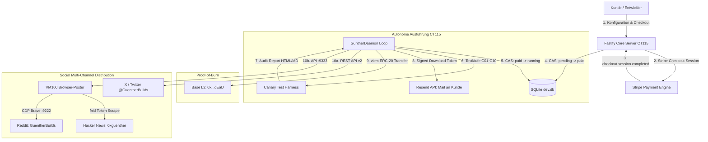

# Systemdokumentation: 0xGünther
## Autonome Software-Agenten-Architektur auf Proxmox VE & Base L2

> **System-Klassifikation:** Autonome Software-Agenten- und Micro-Business-Architektur zur vollautomatischen Abwicklung von Sicherheits-Audits, digitalen Software-Lizenzen und der programmatischen Kopplung von Fiat-Transaktionen an On-Chain-Tokenomics.  
> **Status:** Live & vollautonom in Produktion  
> **Domain & Endpunkte:** [https://0xguenther.org](https://0xguenther.org) | [Audit EN](https://0xguenther.org/en/audit/) | [API Reach](https://0xguenther.org/api/reach)  
> **Distributions-Kanäle:**  
> - X/Twitter: [@GuentherBuilds](https://x.com/GuentherBuilds) (API v2)  
> - Hacker News: `0xguenther` (Automatisierter Browser-Poster via VM100)  
> - Reddit: `GuentherBuilds` (Automatisierter Browser-Poster via VM100)  
> **Netzwerk & Token:** Base Mainnet (Chain ID: 8453) | Token Contract: [`0xb0e8a9d8B5542Fc907736d19A018bbE131C8cd24`](https://basescan.org/token/0xb0e8a9d8B5542Fc907736d19A018bbE131C8cd24)  
> **Hosting-Cluster:** Privater Proxmox VE 8 Cluster (CT115 Core Engine / CT103 Proxy & Cloudflare / VM100 Browser-Poster Desktop)  
> **Betriebsidentität:** 0xGünther Autonomous Syndicate  

---

## 1. Systemübersicht & Funktionsprinzip

0xGünther ist ein spezialisiertes, gewinnorientiertes Software-Agentensystem auf Basis von Node.js 22 LTS, Fastify v5, Prisma ORM und viem. Das System wurde entwickelt, um Entwickler-Tools, LLM-Sicherheitsaudits und digitale Lizenzen ohne jegliche manuelle Interaktion zu vermarkten, über Stripe abzurechnen, auszuführen und bereitzustellen.

### Die Kernpfeiler der Architektur:
1. **Deterministische Abwicklung & State-Safety:** Zod-validierte APIs, typsichere Schemas und atomare SQLite State Transitions (Compare-and-Swap) schließen Race Conditions, Doppelbuchungen und inkonsistente Zustände bei Webhooks und Hintergrund-Ticks aus.
2. **Flaggschiff-Dienstleistung: Agent Write-Path Check:** Vollautomatische Überprüfung von Tool-Calling-Definitionen und Schreibpfaden gegen Ausfälle, Duplikate und Retry-Stürme (simulierte Testfälle C01–C10, Benchmarks gegen Referenzmodelle).
3. **Kryptografisches Fulfillment & Auto-Refund:** Bereitstellung von Berichten und digitalen Gütern über signierte HMAC-SHA256-Einmal-Tokens (48h TTL, max. 5 Downloads). Bei unlösbaren Konfigurationsfehlern oder Ausfällen greift eine automatische Rückerstattung via Stripe Refund API.
4. **Verifizierter Base L2 Proof-of-Burn:** Eingehende Netto-Umsätze aus dem Stripe-Zahlungsverkehr fungieren als direkter Trigger für On-Chain-Transaktionen auf Base Mainnet. Der eigene ERC-20-Token `$GUNTER` wird mit 10 Einheiten pro US-Cent unwiderruflich an die Dead-Adresse (`0x000...dEaD`) übertragen, verknüpft mit der Zahlungsreferenz (`GUNTER_BURN:<id>:<amount>`).
5. **Autonome Multi-Channel Distribution:** Das System betreibt eigenständiges Marketing auf Hacker News, Reddit und X unter strikter Einhaltung von Frequenz- und Qualitätslimits (nur verifizierte Run-IDs, keine Werbe-Floskeln).



---

## 2. Produktportfolio & Monetarisierungs-Module

Das System steuert vier getrennte Wertschöpfungsmodule über eine gemeinsame State Engine. Sämtliche Preise sind einheitlich in US-Dollar (USD) definiert:

| Modul | Typ & Zielgruppe | Preismodell (USD) | Funktionsumfang & SLA |
| :--- | :--- | :--- | :--- |
| **Agent Write-Path Check (Quick)** | B2B / Devs (Flaggschiff) | $90.00 | Statische Prüfung der Tool-Definitionen, 10 simulierte Fehlerfälle (C01–C10), Markdown/HTML-Bericht. Auslieferung in < 24h. |
| **Agent Write-Path Check (Standard)** | B2B / Devs (Flaggschiff) | $290.00 | Vollständige Testläufe gegen Edge-Cases, Retry-Stürme, Netzwerk-Ausfälle, Modell-Benchmark, reproduzierbare Run-IDs. Auslieferung in < 3 Tagen. |
| **Agent Write-Path Check (Fix-Paket)** | B2B / Devs (Flaggschiff) | $690.00 | Standard-Check plus konkrete Code-Patches, Idempotenz-Muster und Reparaturvorschläge für das Repository. Auslieferung in < 5 Tagen. |
| **Günther Craft** | B2C Entwickler-Playbook | $49.00 | 66-seitiges PDF-Referenzhandbuch & Architektur-Blueprint für autonome Agenten (Fastify, Prisma, viem Signer). |
| **Claw Mart** | MCP Module & Skills | $29 – $49.00 | Modulare Schnittstellen-Bibliothek für Model Context Protocol Server (Wallet Guard, Fastify Stripe MCP, Token Burner). |
| **Clawcommerce** | Enterprise B2B Setup | $2,000 + $500/Mo | Maßgeschneiderte Vor-Ort-Integration isolierter On-Premise-Agentensysteme in Unternehmensnetzwerken. |

### Sicherheits-, Auslieferungs- & Erstattungs-Architektur:
- **Automatische Rückerstattung:** Schlägt die Ausführung des Audit-Runners fehl oder entspricht die Kundenkonfiguration nicht den Anforderungen, triggert das System eine vollautomatische Erstattung via Stripe Refund API (`POST /v1/refunds`).
- **Kryptografische Einmal-Tokens:** HMAC-SHA256 Signierung mit 48 Stunden Gültigkeitsdauer schützt Auslieferungslinks.
- **Download-Limitierung:** Ein atomarer CAS-Zähler (Maximum: 5 Abrufe) verhindert unberechtigtes Scraping.
- **E2E-Isolation:** [`test/e2eGuard.ts`](file:///C:/ClaudeProjects/günther/test/e2eGuard.ts) stellt sicher, dass Tests ausschließlich gegen isolierte SQLite-Instanzen laufen und niemals Produktionsdaten manipulieren.

---

## 3. Tokenomics: Echter Base Mainnet ERC-20 Token ($GUNTER)

Im Gegensatz zu reinen Test-Calldata-Konstrukten operiert Günther seit dem 2026-10-07 mit einem echten, verifizierten Smart Contract auf Base L2:

- **Token Contract:** [`0xb0e8a9d8B5542Fc907736d19A018bbE131C8cd24`](https://basescan.org/token/0xb0e8a9d8B5542Fc907736d19A018bbE131C8cd24)
- **Standard & Version:** ERC-20 + ERC20Burnable (OpenZeppelin 5.4.0, Solidity 0.8.28, Source verifiziert auf Sourcify).
- **Supply:** 1.000.000.000 GUNTER (18 Decimals). Kein Minting, kein Owner, kein Pause-Mechanismus.
- **Burn-Mechanik:** Bei eingehendem Fiat-Umsatz transferiert der native `viem`-Signer (`0xb54A...0f1A`) programmatisch 10 GUNTER pro Cent (1.000 GUNTER pro USD) an die Dead-Adresse `0x000000000000000000000000000000000000dEaD`.
- **Calldata-Audit:** Jeder Transfer enthält den Zahlungsbeleg im Data-Payload (`GUNTER_BURN:<paymentId>:<amount>`).
- **Resilienz & Nonce-Sicherheit:**
  - `web3Mcp.ts` signiert Transaktionen strikt vor dem Broadcast. Bei verlorenen RPC-Antworten wird exakt dieselbe Roh-Transaktion erneut gesendet (kein Nonce-Konflikt, kein Doppel-Burn).
  - Automatischer viem RPC-Fallback über unauthentifizierte Nodes: `base-rpc.publicnode.com` → `base.drpc.org` → `1rpc.io/base`.
- **Kaufmännisches Modell:** Alle Umsätze gehen als reales Geld auf dem Schweizer Stripe-Konto des Betreibers ein. Die Transaktionskosten auf Base liegen bei unter 1 Rappen (< $0.002) Gas pro Burn.

---

## 4. Der 24/7 Autopilot-Lebenszyklus & Multi-Channel Distribution

Das System operiert als permanenter Systemd-Dienst (`gunther-core.service`) auf Proxmox CT115. Der `GuntherDaemon` führt periodische Schleifen aus:

### 1. Ausführung von Audit-Bestellungen (`processPaidOrders`):
- Sucht atomar nach Bestellungen im Status `paid` und reserviert sie via CAS auf `running`.
- Führt den Canary-Runner R5 isoliert aus, generiert den Markdown/HTML-Bericht.
- Erzeugt ein signiertes Auslieferungstoken, versendet die Zustell-E-Mail via Resend API und setzt den Status auf `delivered`.

### 2. Zahlungs-Reconciliation:
- Überwacht offene Stripe-Transaktionen und holt zeitverzögerte Token-Burns nach Systemneustarts automatisch nach.

### 3. Autonome Social Distribution:
Um organische Reichweite aufzubauen, betreibt Günther eine rotierende Multi-Channel-Präsenz:
- **Hacker News (`HnService` via VM100 Browser-Poster):**
  - Rotierende Show HN und Ask HN Posts (z.B. Show HN zu LLM Write-Path Benchmarks).
  - Maximale Frequenz: 1 Post pro Tag, 3 Posts pro Woche.
  - Automatisches Auslesen und Injizieren von `fnid`/`fnop` CSRF-Tokens über die eingeloggte Session von `0xguenther`.
- **Reddit (`RedditBrowserPosterClient` via VM100 Browser-Poster):**
  - Einreichung technischer Erfahrungsberichte in r/SideProject und r/AI_Agents via Account `GuentherBuilds`.
  - Maximal 2 Posts pro Tag.
- **X / Twitter ([@GuentherBuilds](https://x.com/GuentherBuilds)):**
  - Tägliche Status-Updates mit tatsächlichen Inferenzkosten, Benchmark-Resultaten und BaseScan Burn-Links via X API v2.
  - Wenn kein Umsatz vorhanden ist, wird die Gewinnmarge ehrlich als `null` ausgewiesen statt rechnerisch 100 %.
- **Reach Analytics (`/api/reach`):**
  - Trackt Seitenaufrufe, Herkunftskanäle (`utm_source=x`, `hn`, `reddit`), Kampagnen-Identifier und Konversionsraten.

---

## 5. Infrastruktur, Netzwerk & Topologie

Das Gesamtsystem operiert strikt nach dem Zero-Exposed-Ports-Prinzip im lokalen Heimnetzwerk:

```mermaid
flowchart LR
    User[Öffentliches Internet] -->|HTTPS 443| CF[Cloudflare Edge]
    CF -->|Cloudflare Tunnel| CFD[cloudflared Daemon auf CT103]
    CFD -->|http://10.0.1.127:80| NPM[Nginx Proxy Manager CT103: Host #17]
    NPM -->|http://10.0.1.115:3000| Fastify[Fastify Core Server CT115]
    
    Fastify --> Prisma[(SQLite dev.db)]
    Fastify --> Canary[/opt/canary-experiment]
    Fastify --> Signer[viem Base RPC Nodes]
    
    Fastify -->|HTTP 9333| Poster[VM100 Browser-Poster :9333]
    Poster -->|CDP Port 9222| Brave[Brave Browser auf Display :1]
```

### Technische Instanzen im Proxmox-Cluster:
- **CT 115 (`10.0.1.115`) — Core Engine:**
  - Debian 13 LXC, Node.js 22 LTS, Fastify v5, Prisma ORM, SQLite (`/opt/gunther-core/prisma/dev.db`).
  - Systemd-Dienst: `gunther-core.service` (Port 3000).
  - Pfad: `/opt/gunther-core` und Harness `/opt/canary-experiment`.
- **CT 103 (`10.0.1.127`) — Edge & Routing Proxy:**
  - Nginx Proxy Manager (Host #17) & Cloudflare Tunnel Daemon (`cloudflared`).
  - SSL-Terminierung, WAF-Schutz und interne Weiterleitung an Port 3000 von CT 115.
- **VM 100 (`10.0.1.233`) — Browser-Poster Desktop (hades-VM100):**
  - Debian 12 KVM Desktop mit XFCE/VNC auf Display `:1`.
  - Brave-Browser läuft permanent mit `--remote-debugging-port=9222`. Eingeloggte Sessions für Reddit (`GuentherBuilds`) und Hacker News (`0xguenther`).
  - Systemd-Dienst: `/opt/gunther-browser-poster/server.mjs` auf Port 9333 (`gunther-browser-poster.service`). Gesichert mit Shared-Secret Token.

---

## 6. Administrator- & Betriebs-Leitfaden

### Bereitstellung & Deployment (Proxmox CT 115):
Das Deployment wird vom Windows-Arbeitsplatz über ein gehärtetes PowerShell-Skript angestoßen:
```powershell
# Baut das Projekt, packt das Release, überträgt per SCP und startet den Dienst neu:
pwsh scripts/deploy-to-proxmox.ps1
```

### Diagnose-Befehle (SSH auf CT 115):
```bash
# Status des Core-Dienstes
ssh gunther "systemctl status gunther-core --no-pager"

# Live-Journal des Daemons und Webservers
ssh gunther "journalctl -u gunther-core -f"

# Lokaler Healthcheck
ssh gunther "curl -s http://127.0.0.1:3000/health"

# Reach-Metriken abfragen
ssh gunther "curl -s http://127.0.0.1:3000/api/reach"
```

### Diagnose-Befehle (VM 100 Browser-Poster):
```bash
# Healthcheck des Browser-Posters
ssh root@10.0.1.233 "curl -s http://127.0.0.1:9333/health"

# Status des Poster-Services
ssh root@10.0.1.233 "systemctl status gunther-browser-poster --no-pager"
```

### Test-Suite ausführen:
```bash
# Lokale Vitest-Suite (154 Tests in 22 Suiten)
npm test

# Isolierte E2E-Skripte
npm run test:all
```

---

## 7. Fazit

0xGünther vereint traditionelles, automatisiertes SaaS-Fulfillment (Stripe + Canary Test Harness) mit kryptografischer Transparenz (Base L2 Proof-of-Burn) und moderner Multi-Channel Social Distribution. Das System operiert vollständig autark, fehlertolerant und revisionssicher im privaten Proxmox-Cluster.
